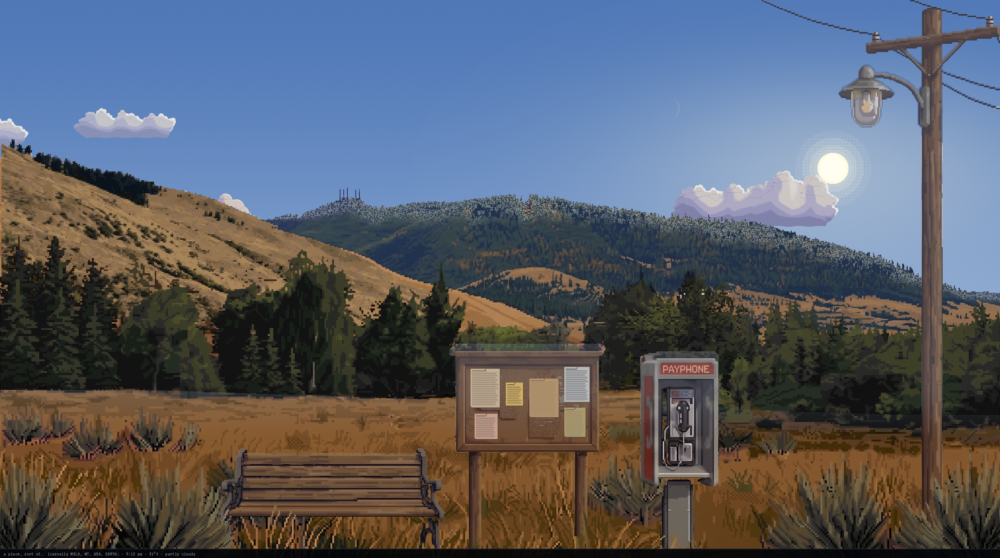

# a place, sort of.

A quiet park scene that lives on the real clock and sky over Missoula, Montana. A bench, a bulletin board, a pay phone, a pole with a lantern, Mount Sentinel on the left and Mount Dean Stone's forested dome behind. The sun, moon, stars, clouds, snow and fog are the ones outside right now. Nothing to win.



The mood is hauntology, in Mark Fisher's sense: a place remembered more than seen, with the medium's wear left showing. Boards of Canada is the muse. The pixel art is hi-res and shaded, with visible pixels and dither, never chunky and never painterly. Three rules sit over everything, spelled out in `CLAUDE.md`: beauty over realism (live data says what is happening, never what color it is), the user's paintings and photographs are the look (code only adds light, weather and what changes), and `master` is production.

## See it

https://liminalbench.net/ (Cloudflare Pages, redeployed on every push to `master`). The board and the answering machines there are shared and public.

The older copy at https://foodbark.github.io/liminal_bench/ still builds from the same branch with a browser-only board, until it is retired with a redirect.

## Run it

```
npm run dev                     # http://127.0.0.1:5173, static, no build step
npm run lan                     # 0.0.0.0:5174 for phones on the home network
npx wrangler pages dev . --port 8788    # the Pages Functions (board, posters, voicemail, cams) over a local D1
```

Everything is native ES modules from `index.html`; the only automated check is `node --check` over `src/`. `?debug` opens the debug panel (or press `D`): override the hour, month, weather, cloud cover, moon, peak snow and paragliders. `?diag` overlays the loading stages, the weather and cam readings and any errors, for a phone that cannot open dev tools. `?small` / `?full` force the half-size or native build. `?noworker` runs the terrain pass on the main thread.

The dev server also proxies the two webcams at `/api/cam/NAME`, so the cam-read cumulus works locally.

## Build it

```
python3 tools/build_backdrop.py [--art NAME] [--debug DIR] [--scale N]
```

Turns the painting named in `art/current` (now `layered_photo`) into `assets/`: the painting with the sky masked out and the cork cleared, a per-pixel mask (depth plane, material, height fraction within the plane), the close-up paintings, the paraglider wings, the beacon pixels on the masts, and `backdrop.json` with every art-specific number the page needs (horizon, hotspots, cork, lantern, camera targets, fog lines, snow caps, default notes). A half-size copy of all of it goes to `assets/small/` for phones. `--debug DIR` writes mask overlays, and you look at them. About a minute.

The build only masks, classifies and cleans what is painted. It straightens the masts on Dean Stone, takes the masts and tree tips off the crest line before measuring heights (so the fog ceiling does not streak under every mast), fills the one deep sky channel the checkerboard export cut into Dean Stone's right summit, and keys the config's `erase_sky` and `front_erase_tan` rectangles out of the front painting. It invents nothing.

```
python3 tools/pixelate.py PHOTO OUT.png --as mountain|trees|prop|photo [--size WxH] [--pixel N] [--flatten N] [--hues N] [--steps N] [--ink K] [--dither K] [--pop K]
python3 tools/swap_flank.py CUTOUT --scale S --dy DY
python3 tools/cut_cloud.py PHOTO OUT.png [--box fx0,fy0,fx1,fy1] [--clip [lrtb]] [--all] [--list] [--fill box]   # cut one cloud from a photo
python3 tools/build_clouds.py                                                             # assets/clouds.png, lobes.png, field.png from the config's clouds and fields
node tools/screenshot.mjs out.png "<js run on the page first>"
```

`pixelate.py` turns a photograph into shaded pixel art with no model: box-average onto the art grid, pop, an edge-keeping flatten, hue-family ramps taken from the photo, a palette snap, ink on strong edges. The loss it produces (flattened ramps, a snapped palette, lost fine detail) is the look, so it is not tuned away; a result that reads as memory stays, one that reads as a broken image gets fixed. `swap_flank.py` is the bridge while the scene is part photo and part painting: it keys a photographed Sentinel cut-out, shaves its halo, pixelates it and lays it over the painted flank. `screenshot.mjs` renders the page at native size in headless Chromium and is how every rendering change gets checked (set `LIMINAL_URL` when the port is taken).

## What it does

**The light.** Sun and moon positions for Missoula in real time; the sky palette keyframed by sun altitude. The valley loses the sun early and the crests keep it late, so the shadow line climbs each hill as the sun drops. Alpenglow is warm light, a multiply plus a little brightness, so forest stays dark green and grass goes orange; after direct sun leaves a face the glow still washes it. A rim of light marks every silhouette against what is behind it, warm at dusk and silver under the moon. Sentinel is backlit at dawn: a shadowed face with a burning outline. Open-Meteo reports low, mid and high cloud separately, and they are weighted into a shade value that grays the palette and holds back the glow, so a cirrostratus sunset is pink end to end and not an overcast.

**The sky.** The three cloud bands become cirrus, a cirrostratus veil, altocumulus fields, an altostratus veil, fair cumulus, a stratocumulus sheet, flat stratus in fog, nimbostratus under rain, and in a storm one cumulonimbus with lightning. Sheets are drawn once in the worker with a cloud-deck perspective and scrolled with the wind; cumulus are seeded cauliflower sprites in five flat tones that take the sun's color at low sun and the moon's at night. The big soft areas dither through a blue-noise tile, not a Bayer lattice. Since 2026-10-13 the valley webcams fill in what the feed misses: Open-Meteo said 1% under an afternoon of fat cumulus behind the ranges, so two public stills (Mountain Press from the South Hills, KPAX downtown) are proxied by a Pages Function with a ten-minute edge cache and the page reads the sky above each cam's ridges for cloud, raising the low cover to what it sees, only upward and only by day. Since 2026-10-15 they read the fog too: the model said clear and 18 km visibility on a morning the valley was socked in, and a fogged frame is flat, so the texture of each cam's hills says fog, the KPAX cam deciding and the Mountain Press cam, up the South Hills, saying how deep it is.

**The night.** The Yale Bright Star Catalog placed by sidereal time, the five naked-eye planets from mean orbital elements, the Milky Way as a dithered band on dark clear nights, shooting stars (more around the showers, from their radiants), and the user's painted moon with its phase cut away, lighting the clouds silver when it is up. Twinkle follows one model (below). Hover a bright star or a planet for its name. The masts on Dean Stone carry red aircraft beacons that blink slowly through the night, each on its own clock.

**The weather.** Rain and snow as scrolling tiles, rain darkening the ground, fog bands, an inversion that fills the far valley with a flat-topped sea in a cold month and hazes the whole sky above it (and, when the cams have the fog deep, up the lower slopes, across Sentinel's flank and into the trees, the meadow and the props at the bench), mountain fog that hangs banks on the slopes and, when the low cloud is solid, a ceiling the crests go up into. Blowing snow from 15 mph over loose snow, a blizzard by 30: streaks in the wind, a drift off the meadow, the mountains whited out. Wind drifts the clouds and the paragliders. Paragliders work Sentinel's ridge on fair days with a light west wind (inferred from the weather, no feed, and weighted by the week since 2026-10-20: few during weekday business hours, many after work and on a weekend afternoon, when a whole club of ten can be up): the user's photographed wings, two or three times true scale the way the moon is, in front of Dean Stone and behind Sentinel and the trees.

**The planes.** The aircraft over the valley are real, from adsb.lol (a community ADS-B feed, no key), proxied by a Pages Function with a 30-second edge cache and read every half minute: the east-west corridor at cruise, a dozen jets at a time, the small aircraft on the approach over Sentinel, the airliners in from Denver and Salt Lake up the Bitterroot valley and in over the South Hills. Each is dead-reckoned between fetches and placed in the sky from the bench by its real azimuth and elevation, through the same mapping as the sun. By day a speck and a contrail laid along its own path and carried on the upper wind, lasting what the 250 hPa humidity allows (a dash in dry air, a streak across the sky in moist), in the hour's cloud tones; by night the lights, a white strobe, a red beacon, each on its own clock, crossing the stars. Behind the cumulus, hidden by the ridges, dimmed by a deck. Hover one for its callsign, airframe, altitude and heading, the callsign in capitals like a departures board. A plane never flies backward: a fresh report that sits behind the reckoning holds it still until the reckoning catches up, and a ratchet forbids any against-track motion. Low traffic is sized by wingspan over distance and drawn at its depth, in front of Dean Stone and behind Sentinel inside ten kilometres, in front of Sentinel too under a mile, with a landing light when it is heading our way; the planes themselves will be the user's photographs, a speck standing in until they come. Built 2026-10-21 on the `worktree-flights` branch.

**The snow.** None of it is on a calendar. A second Open-Meteo query lapsed to Dean Stone's summit latches the season's first real accumulation (5 cm held for half a day) in the browser for one snow year; until it fires, fall is bare whatever the month table says, and after it the table and the live summit depth decide how white the peaks are. A first snow whitens Dean Stone's top and nothing nearer, and when the summit model goes bare again it fades off over a few days and the latch lets go, so a melted October snow does not rim the crest until the next one. The overnight dusting is a budget: the valley feed's last three days lapsed to each plane's elevations and walked hour by hour, what fell as snow up there against what melted since, each plane melting at its own rate by aspect, since the bench looks south and every face it sees of Dean Stone is a shaded north face that holds a dusting for days while Sentinel's open west face is bare by the next afternoon. The ground goes white when the station says there is snow on it.

**The grass.** Sentinel's slope and the meadow follow the grass year relative to the painting's September, green in spring and gold by August, and green back up some after a week with rain in it and two warm days since.

**The bulletin board.** Click it and you stand at the board, the notes set legibly on a close-up of the cork. Pin a note (one line, 80 characters): write it, then carry it to the spot on the cork you want and click; it yellows over a year, still readable at the end; nothing on the board blows away, it stays until someone tears it down or newer paper buries it, and at forty pieces of paper there is not a pin left until something comes down. Anything can be picked up and pinned somewhere else to make room, yours or not: press and hold it, or just drag it, and it rides on the pointer; let go and it is pinned there, on top of the pile; dig through the old stuff that way without taking anything down. Pin a picture from your device: it is turned into pixel art in the browser before it goes anywhere (a port of `pixelate.py`), cropped to a handbill, a flyer or a big sheet, and pinned beside the notes; past the slots, older posters and notes pile up under the newest, and a poster bleaches in the sun over the year. Click a poster to hold it up. Anyone can tear any note or poster down, the way a real board works, and that is the only moderation. On liminalbench.net the board is shared through a Pages Function over D1, rate-limited per address and in total; anywhere else it lives in the browser.

**The pay phone.** Click it: the receiver lifts and there is a dial tone. Dial on the keypad or pick a number from the book. Most numbers get an intercept in Jane Barbe's own voice, from a collector's compilation, with the SIT tones in front: a number nobody has in the 555 exchange is "not in service", any other exchange "cannot be completed as dialed" (the book's crossed-out "home" listing finds out). A few numbers work: the time and temperature from the scene's own clock and feed, the phone company's line (her whole compilation, her interview at the end), and the bench's own listing, which is this phone and so is busy. The book's number in Budapest lands on the 2002 AT&T operator menu and then the off-hook howler, unless the caller carries a blue box or a Cap'n Crunch whistle, which blows into the mouthpiece a few seconds in and cuts the menu off mid-word; then a European ring, and a pastry shop's answering machine takes a message. Every tone is made in Web Audio; nothing sounds until the receiver is lifted. Messages left on the machines go to the `voicemail` table beside the notes.

**The platform.** The sky gradient, the cloud sheets and the terrain pass run in a Web Worker and come back as bitmaps; the page composites them under the camera transform and skips idle frames entirely, which is what makes a 2752-wide scene affordable. A loading screen covers the first seconds until the weather has answered, the notes are in and the terrain is lit for the current conditions. Screens under 1100 px get the half-size build. Phones get readable captions, tap-to-enter and a rotate hint; a real landscape layout is still to come.

## How it is put together

**One environment object drives everything.** Each frame `computeEnv` in `src/main.js` builds `state.env` from the time (or the debug override), the sun and moon, the live weather and the cams, and the palette, and derives the conditions (inversion, mountain fog, the dusting tables, blowing snow, the sheet mix). Renderers read only `env`. The worker passes are rebuilt only when their key string changes, so an input that is not in the key never shows.

**The scene is the user's painting, re-lit.** `assets/backdrop_mask.png` tags every pixel with a depth plane, a material and a height fraction within the plane; the terrain pass lights each plane with its own sun horizon, haze depth, snow bias and dusting elevations. Each painting has `art/NAME.json`: the files (the back painting, the prop-less bare copy, a front painting layered over it with its checkerboard keyed out, close-ups), the traced silhouettes, the prop boxes and everything that ends up in `backdrop.json`. When a new painting arrives, the traces are re-measured, not reused.

### The painting: 7 depth planes, 4 in use

| code | plane | in `layered_photo` |
|---|---|---|
| 0 | sky | masked out; the procedural sky shows through |
| 1 | peak | unused, reserved for Lolo Peak behind Dean Stone's shoulder |
| 2 | range | Dean Stone (painted), all foliage: canopy snow in the gaps, holds a dusting longest, takes the alpenglow strongest, carries the masts and beacons |
| 3 | far hill | unused in this painting |
| 4 | flank | Mount Sentinel, from the user's photo: grass, backlit at dawn, sunset glow on the face, bare again a day after a dusting |
| 5 | trees | the valley trees |
| 6 | near | the meadow and the painted props |

Materials in use: grass, foliage, dirt, shrub, prop. There is no painted summit snow, so every bit of snow on the peaks is the terrain pass.

### The frame, back to front

1. Sky gradient (worker), the Milky Way in it on dark nights.
2. Moon and sun: the painted moon with its phase cut; the solid sun disc with a dithered corona, never a dithered disc.
3. Terrain (worker): the painting re-lit in one pass.
4. Fog bands, the props' shadows, what changes on the props. Items 3 and 4 are `fg`; 1 through 4 are `base`.
5. Thin cloud sheets (cirrus, the veils, altocumulus), scrolled with the wind, under the stars so a wisp dims a star instead of strobing it.
6. Stars and planets, redrawn ten times a second.
7. Meteors, behind the ridges.
8. Thick cloud sheets (stratocumulus, stratus, nimbostratus).
9. The aircraft: specks and contrails by day, lights by night, dimmed by a deck in front.
10. Cumulus, the cumulonimbus, the lightning.
11. `fg` again, so the clouds and the planes sit behind the mountains.
12. Paragliders, then the near planes back over them; the low aircraft the same way, and the closest in front of Sentinel with only the trees and the props back over them.
13. The beacons on the masts, the lamp glow.
14. The close-up painting when standing at a prop.
15. Precipitation, blowing snow, the lightning's flash.
16. A poster held up, over everything.

## Layout

```
index.html, style.css        shell, the band (the Sierra line under the picture: status, caption, and the words, fields and buttons of whatever is open), the phone's box, the loading screen
src/main.js                  the loop; computeEnv builds the environment from time, sun, weather, cams, palette
src/state.js                 constants (the station, the summit, the season table), the override, time helpers
src/weather.js               Open-Meteo: the valley station and the hourly week, the summit query; presets
src/cams.js                  the webcams read for the cumulus and the fog the feed misses
src/flights.js               the aircraft feed and the geometry: dead reckoning, azimuth and elevation from the bench, the contrail's life from the upper air
tools/push_flights.py        pushes the aircraft feed to the site from a machine with its own address (docs/deploy.md section 6)
src/dusting.js               the overnight dusting as a snow budget by elevation and aspect, per plane
src/season.js                when snow arrives on the peaks: the summit latch over the month table
src/palette.js               sky and light keyframes by sun altitude
src/notes.js                 the board's notes and posters: localStorage, or the API where it answers
src/pixelate.js              the browser port of tools/pixelate.py, for posters
src/phone.js                 the pay phone: dialing, tones in Web Audio, intercepts, the time line, machines, items
src/items.js                 what a visitor carries (the whistle, the blue box); nothing hands them out yet
src/ui.js                    hotspots, camera zoom, the band (the note form, the tear question, the bench's words), the phone panel, debug controls
src/assets.js                loads the painted scene and its mask (worker-safe)
src/render/renderer.js       the compositor and its caches; the worker's client
src/render/terrain_worker.js the sky gradient, the sheets and the terrain pass off the main thread
src/render/terrain.js        re-lights the painting: grass, snow, the dusting, fog, light, rim, moon
src/render/sky.js            the sky gradient, stars, planets, twinkle, the Milky Way, moon, sun
src/render/sheets.js         the cloud sheets, drawn once in perspective and scrolled
src/render/clouds.js         cumulus sprites and the cumulonimbus
src/render/weatherfx.js      the cloud field, rain, snow, blowing snow, lightning, meteors
src/render/gliders.js        paragliders off Sentinel
src/render/beacons.js        the aircraft beacons on Dean Stone's masts
src/render/flights.js        the aircraft: specks and contrails by day, strobes and beacons by night
src/render/props.js          what changes on the painted props: notes, snow caps, shadows, the lantern
src/util/                    solar.js (sun, moon, sidereal time), planets.js, pixel.js (integer drawing, dither), noise.js, bluenoise.js
art/                         paintings, photos and a JSON config each; art/current picks one
assets/                      what the build writes; assets/small/ the half-size copy; assets/audio/ the phone's voices and numbers.json
assets/stars.json            the Bright Star Catalog to magnitude 5.2
functions/api/               Pages Functions: notes.js, posters.js, voicemail.js over D1 (db/schema.sql, wrangler.toml); cam/[name].js the webcam proxy; flights.js the aircraft feed (three feeds, a shared copy in D1, a pusher's POST)
tools/build_backdrop.py      the painting to assets/
tools/pixelate.py            a photograph to shaded pixel art, no model
tools/swap_flank.py          a photographed Sentinel into the painted front
tools/screenshot.mjs         the page at native size in headless Chromium
tools/phone_voice.mjs        a voice take through the telephone band
tools/forest_study.py        does the painting tell larch and deciduous from fir?
tools/make_bluenoise.py      the blue-noise tile (run once)
docs/deploy.md               Cloudflare Pages, D1, the domains, retiring GitHub Pages
docs/webcams.md              the Missoula webcams, which are usable and which are in use
```

## Open

Roughly in the order they matter.

- **Dean Stone from a photograph.** The painted dome stays behind the photographed Sentinel until a photo works. Two tries failed: the sunny wide shot came out as one navy mass with a spiky white fringe where lit treetops snapped pale, and a drone shot was too far. Wanted: flat overcast light, close, a frame that includes the foothills in front of the dome, 3000 px or more across the mountain. The photographed cork board was tried on 2026-10-12 and dropped the next day; the painted board stays.
- **The sky from photographs** (the `clouds` branch, started 2026-10-17, merged to master 2026-10-20). The cumulus are the user's photos now: `tools/cut_cloud.py` keys the sky out of a photo by blueness and cuts one cloud per box in the config's `clouds` list (a clipped or frame edge moved onto the darkest seam through the folds, wisps opened away), `pixelate.py --as cloud` snaps it to two hue families with no pop and the mids lifted, `tools/build_clouds.py` packs the 25 clouds into `assets/clouds.png` and, through `tools/lobes.py`, the near ones' bumps into `assets/lobes.png`: a cumulus is a mass with thermals bubbling out of it and a fold only where two pressed together, so the watershed's basins are merged wherever the boundary between them is not a real shadow seam (tested cell by cell against the cloud a little way into each side), until every cut is a fold and every bump's outline is sky or seam (2026-10-20; the raw watershed had met along rows and columns wherever there was no fold to follow, and the lobes stood on the bench with ruler-straight sides). On the page (`src/render/photoclouds.js`) a near cumulus is built by the drawn clouds' grammar on a photographed mass: a tower of one or two bumps seated deep, a big scallop or two, only bumps whose top and upper flanks were sky, drawn from the top down so every seam cut hides behind the piece below; far rows are single puffs; the sprites are recolored by lightness through the hour's cloud tones against a clear noon (white by day, the moon's silver on the crowns and the town's glow on the bases at night); the deck sits low so bases are behind the ridgeline; the storm's cell is `cumulonimbus_02`. Debug skies `cumulus` and `cumulonimbus`. **Pinned there (2026-10-17): building over time.** The parts list is ready for it: a cloud appears as its base and gains its tower lobe by lobe, each rising at a real turret's pace (one to three minutes, visible to a one-minute look), the whole life paced to the twenty-minute crossing of the frame, the field seeded with mixed ages so a glance already shows a sky in motion. The pacing comes from the feed, not the clock: the last few hours of low cover (rising: towers and boiling lobes; falling: broad softening masses, no new towers; flat: a mixed field that drifts) with the cams added and the sun's height only as a lean, since Missoula clouds do not always play by the textbook's rules (an evening build-up shows as what it is). A storm day is the same clock pointed at the cell. The altocumulus field is the user's photo as well (2026-10-20): the whole sky band of `alto_cummulus.jpg` keyed, pixelated as one image so a cloudlet in shade stays gray beside one in sun, and sliced into forty cloudlets (`assets/field.png`) that the page lays on the sheet deck by the photo's own arrangement, repeated across the frame, thinned by the feed's mid cover (the densest patches survive, the strays go first), recolored in depth bands at half the cumulus lift. The cirrus too (2026-10-20): the whole frame of `cirrus_02` keyed against the sky's own blueness, its soft alpha kept as a density per cell (`assets/cirrus.png`), repeated across the sky, the feed's high cover deciding how thin a density still shows. Since 2026-10-21 it is drawn as mist, the way the Milky Way is: the density through the blue noise at a fixed screen position, the density drifting under the stipple instead of the pixels scrolling, combed into mares' tails along the 250 hPa wind, the cirrostratus veil a slow haze under the hooks, and the mackerel sky from the user's photo of rippled altocumulus rows (2026-10-23; before that a stand-in from the first altocumulus photo's cloudlets). The overcast decks are the user's photographs too (2026-10-21): a mammatus sky as the stratocumulus and a rain sky as the nimbostratus, their luminance stippled near solid in the hour's deck tones, breaking open on the lightest lumps with bright sky in the gaps. Still drawn by code: the stratocumulus (a photo wanted: a gray lumpy deck from below with blue in the gaps), the veils (from the cirrus photos' whiteness), and the storm palette, which makes the photographed cell dull olive; a cell seen from under it, base and rain shaft, is the photo wanted most, plus one at evening and a congestus mid-build. Lessons: lobes alone laid out as hemispheres read as popcorn (the grammar needs a mass), a band of shade between lobes read as a pencil outline, three stacked lobes with shoulders read as vertical, and a cloud cut off by the camera's own frame cannot be fixed by any seam.
- **The seasonal trees.** Everything that changes color here is scattered inside something that does not: larch through the fir on Dean Stone, deciduous trees among the valley spires. The painting cannot tell larch from fir (`forest_study.py`, 2026-09-28), so Dean Stone's larch need a repaint; the valley trees can be classified from the painting and want a `DECIDUOUS` material (the mask's codes re-spaced to 16 apart to make room). Bare winter trees are a painted state, not a tint, since nothing was painted behind the leaves. The plan is one phenology table keyed by material (color and leaf mass by day of year), so every seasonal question becomes data.
- **Lolo Peak** in the unused peak plane, right of Dean Stone's shoulder: higher, twice as far, paler, snow into July. Needs the user's painting of the upper massif, a `back` option in the build, its own snow lapse.
- **The pay phone's remaining voices**: the time line in Barbe's voice needs her digits spliced from the drum sets; the answering machines; the phone close-up with the keypad painted on it.
- **An inventory**: a pocket of painted items, look and use-on-target, the whistle blown on the phone by hand instead of the automatic interrupt; items found in the trash and on the board. The plumbing exists (`items.js`, the phone's `requires` and `opens`); `?give=whistle` hands one over for testing.
- **The phone's own number**: busy when alone, ringing another visitor's booth when someone is there, a typed call through the handset. Needs a presence channel (a Durable Object, or polling on the free tier).
- **A rare visitor on the bench**, and whose answering machine the machines are.
- **Cloud shadows** crossing the hills as the cumulus drift. Complicated; wanted some day (2026-10-13).
- **The open-topped trash can** (user's art) with critters; wind-swayed foliage; a real mobile landscape layout; the second domain's redirect and retiring GitHub Pages (`docs/deploy.md`).
- **Photos wanted** (2026-10-21; the cirrus and the mackerel sky came 2026-10-23, `cirrus_03` and `overcast_04`): an airliner and a small plane on approach from below and a little to the side, for the low traffic's sprites (the page loads `assets/planes.png` and `planes.json` if they exist; the cutter is written when the photos are, to be tuned on them); the stratocumulus and the rain base have photos now (the mammatus over Denver, the rain sky), the flat stratus is still drawn; still the cell from beneath.
- **Satellites** from CelesTrak elements, shown only when sunlit against a dark ground. **Planes** are built (2026-10-21, `worktree-flights`; see below): still wanted there, a plane's own shadow on a contrail-lit dawn, the approach lights at night, a debug switch to force a sky of them. **Smoke season** from PM2.5, in August 2027 when there is smoke to look at. A camera of our own on Sentinel for the ceiling and the snowline, now that the public cams carry the cumulus.

## Design notes worth keeping

### How a star should twinkle (2026-10-09)

An evening of tuning by hand (bigger swings, smaller, faster, slower, size flicks on and off) never got it right: every version either did nothing or blinked stars out. One model fixed it:

- **Conserve the light.** The atmosphere smears a star's light over a bigger or smaller patch; it does not switch it off. A spread star is larger and dimmer per pixel, a sharp one small and bright, and the total barely changes. Size and tone move together through one spread value, inversely; every version that moved them independently read as blinking.
- **The points cycle, they do not blink.** The spikes are made by the eye; they shimmer because the light entering it is churning. Points swinging between upright and diagonal keep the light constant and read as sparkle.
- **Time structure is the whole difference between twinkle and noise.** Real scintillation is mostly calm with rare sharp glints, not a coin toss ten times a second. A slow wander per star plus a rare glint leaves the sky quiet except for what the eye catches.
- **Color, low down.** A glint under about fifteen degrees takes a brief red or blue tint, the way Sirius does over a ridge.
- **Planets steady, the faintest stars steady.** A planet is a disc and barely twinkles, which is how people tell them apart. A single-pixel star can only ever appear on a flick, so it is left alone.

### The pay phone's voice: Jane Barbe (2026-10-10)

The phone speaks in the voice every pay phone had: Jane Barbe, who recorded the Audichron and Electronic Tele-Communications announcements for thirty years. Her intercepts come from the compilation on Telephone World, cut into the two lines the network used. The machines assembled her time and temperature from fragments (each hour, minute, degree), and collectors have digitized the drums, so the time line can one day say tonight's real time from the scene's clock the way the machines did; until then it is a transcript over the tones. Rights: corporate recordings never released under a license, common on hobby sites and low risk but not clean; a collector set with stated terms, or an actor reading new lines in her cadence, would be. Not a voice model: she was a real person, died 2003, and that is the wrong kind of resurrection for this place. For the lines she never recorded, `tools/phone_voice.mjs` puts a take through the telephone band (300 to 3400 Hz, mono, 22 kHz, a touch of compression) so it sits beside her clips. The international line is better than anything we could write: the real 2002 AT&T operator menu, a wall of "press 1 for a calling card call" with nothing this caller can press, then the howler, which is what a pay phone that cannot bill the call did.

### Contrails are a humidity question, and the data is there (2026-10-07)

A day of contrails that spread instead of fading: Open-Meteo had 250 hPa at -50°C with relative humidity 42 to 56% over water, which is 70 to 92% over ice (the saturation ratio at -50°C is about 1.65). Contrails persist when the air is supersaturated over ice, and a grid-mean model almost never reports that, so the rule has to be a threshold well under 100% over ice: the morning's 85 to 92% is what long-lasting looks like in this feed. 300 hPa was far drier, so the level matters. The early light is already in the code: a contrail at 10 km sees the sun from 3.3° below the horizon while the meadow waits for +4.5°, and `cloudTones` already blazes undersides through that window. Built 2026-10-21 (`src/flights.js`, `contrailLife`): the feed's 250 hPa humidity over water, 20% a ten-second dash, 50% and up the full ten minutes, nothing warmer than -40°; the trail drifts on the 250 hPa wind.

### Webcams (2026-09-03, built 2026-10-13)

Forecast data says how cloudy it is; a camera says where the clouds are. The first survey found the public Missoula cams unsatisfying and planned our own camera on Sentinel with a small service publishing ceiling, snowline and sky color as JSON. What got built instead is simpler: the two usable public stills proxied by a Pages Function and read in the browser for cloud fraction above the ridges, a pixel counting as cloud when it stands out from its row's median either way or sits in texture, since color is useless (one cam's blue cast makes cloud white bluer than the other's sky). The ceiling and the snowline from a camera are still the plan for our own.

## Log

- **2026-09-03** The scene, procedural, with live weather. The weather ideas list, the beauty rule, the webcam idea.
- **2026-09-05** The painting becomes the scene: a 2752-wide Gemini painting, re-lit; no code-drawn props, ever again.
- **2026-09-23** Fall backlog: the deciduous split is a year-round investment; spring bloom; flight data.
- **2026-09-28** Two days in Denver: peak snow on data not the calendar, the bulletin board with a close-up, the Pages Function over D1, the move to Cloudflare Pages, liminalbench.net, a first mobile pass. Satellites and Lolo Peak noted.
- **2026-10-03** `tools/pixelate.py`: photographs to shaded pixel art, the start of replacing the generated paintings with the user's own photos.
- **2026-10-05** Hauntology is the mood, Boards of Canada the muse; the decay from the conversion is kept.
- **2026-10-07** Contrails seen and measured. Paragliders off Sentinel, from the day's photo, built the same evening.
- **2026-10-08** Mount Sentinel from the user's photo, in front of the painted Dean Stone. The shade value for the cloud bands. Planets. Hover captions for the named stars.
- **2026-10-09** The twinkle model, after a night of versions that blinked.
- **2026-10-10** The pay phone: dialing, tones, Jane Barbe's intercepts, the time line, the machines, items, the international line and the whistle. Tearing notes down. Posters. Blowing snow.
- **2026-10-11** Grass green-up after rain. The loading screen. Blue-noise dither everywhere soft. Cloud sheets as shapes. Heavy mountain fog with a ceiling. The masts straightened, the beacons lit. The build's crest cleans.
- **2026-10-12** The dusting as a snow budget by elevation. The tan band over the foot of Dean Stone keyed out. A photographed cork board tried.
- **2026-10-13** The cork board dropped. The webcams read for cumulus. The dusting melts by aspect, so Dean Stone holds it and Sentinel does not. A first snow stops at Dean Stone.
- **2026-10-17** A high veil never grays the sky, and the sun shows through it (master). The `clouds` branch: the cumulus from the user's photos, cut, pixelated, assembled by the old grammar with a lobe library, lit for the hour and the night, the storm's cell from a photo; building over time pinned, to be paced by the feed's cover trend.
- **2026-10-20** The `clouds` branch, merged to master at the end of the day: mass plus bumps. The lobe library became a bump library, each bump cut along its shadow seams and nothing else, and the sharp corners on the cumulus went with the straight creases. The altocumulus field from the user's photo, laid out by the photo's own rows and thinned by the feed. The cumulonimbus recut with its anvil (the clip per side, the pole filled from the cloud beside it, the tower over Dean Stone with the base behind the crest and the anvil off the frame, most of its gray kept outside a storm), and the stratocumulus waits on a photograph. The paragliders follow the week: few in weekday business hours, a club of up to ten on a weekend afternoon. The cirrus from `cirrus_02`, keyed to a density per cell and shown by the feed's high cover; the debug cover slider scales the cover bands instead of only darkening the scene.
- **2026-10-15** The first snow melts off: the latch fades and lets go when the summit model goes bare, instead of holding a white rim until August. The webcams read for fog: a flat frame on a cold morning is the inversion, deep enough to climb the slopes when the South Hills cam is in it too.
- **2026-10-21** The planes: live aircraft from the community ADS-B feeds, specks and straight contrails by day (the far end of a long trail where the grid's bow was), strobes and beacons by night, a landing light for one heading our way, the far traffic cut at 7 degrees and by airframe size and capped at three, the low traffic drawn at its depth with a speck standing in for the photos; the feed kept alive by a pusher (the Function cannot reach the feeds from Cloudflare's shared addresses), on GitHub Actions. The bench placed just south of the university. The cirrus as mist, the way the Milky Way is drawn, after the thread experiment was rejected; mares' tails combed along the upper wind; the cirrostratus veil as haze; the mackerel sky a stand-in from the altocumulus cloudlets. The status line bigger on a desktop.
- **2026-10-22** The overcast decks from two of the user's photographs: a mammatus sky as the stratocumulus, a rain sky as the nimbostratus and the stratus, the gaps bright sky; the altostratus veil as haze; the fish scales feathered at their cut sides and no longer mirrored. The deep fog reaches the bench and the inversion hazes the sky. The planes stop sliding back (the feed copy's own time, a hold, a ratchet), their captions in capitals, the contrail closer behind. The board probes its API again on every pin. Cloudflare's git build stalled for two pushes and master was deployed by hand; it fired again by evening. Later the same day: the overcast keeps its gray away from the sun at sunset, only the callsign in a flight's caption is in capitals, and the low traffic's stand-in bar, a white rectangle on a big screen, became a speck.
